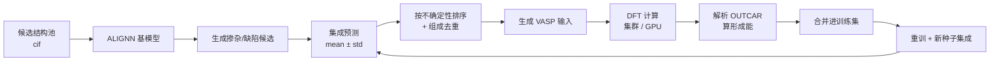

# ALIGNN Active Learning Loop

> 一个能真正跑起来的「机器学习势/图网络 + DFT」主动学习闭环：**DFT 数据回传 → 合并训练集 → 多模型集成训练 → 不确定性采样 → 生成下一批 VASP 输入**。

用于材料性质（形成能 / 带隙）的高通量筛选：把有限的 DFT 算力花在模型最不确定的结构上，而不是均匀撒钱。

以 LiFePO₄ 体系（掺杂 / 缺陷）为开发与验证背景，但流程与体系无关。

---

## 闭环长什么样



每一步都是独立脚本，可单独跑、也可由 `active_loop.py` 一键串起来。

---

## 快速开始

```bash
# 1. 环境（ALIGNN 官方依赖较挑版本，DGL 锁 1.1.2）
conda create -n alignn python=3.10 -y
conda activate alignn
pip install -r requirements.txt

# 2. 结构 + 标签 → ALIGNN 数据集（80/10/10）
python prepare_alignn_data.py

# 3. 训练基模型（RTX 4090 上约 8 min / 400 epoch）
python train_alignn_energy.py

# 4. 一轮完整闭环（数据已回传的前提下）
python active_loop.py --round 2 --parse --merge --train --sample --vasp --n_models 4
```

输出落在 `vasp_jobs/doping_round<N>/`，可直接打包丢给集群。

---

## 脚本清单

| 脚本 | 作用 | 输入 → 输出 |
|---|---|---|
| `prepare_alignn_data.py` | CIF + 属性表 → ALIGNN 标准 JSON 数据集 | `data/structures/*.cif` → `data/alignn/{formation_energy,band_gap}/{train,val,test}.json` |
| `train_alignn_energy.py` | 训练形成能模型，自动 batch 降级，存最佳权重与评估图 | `train.json` → `models/alignn_energy_best.pt`、`runs/`、`figures/` |
| `active_learning.py` | 从超胞生成掺杂/缺陷候选并预测 | 超胞 cif → `data/candidates/*.cif`、`round1_query.csv` |
| `ensemble_uncertainty.py` | **4 个不同种子模型**集成，输出 mean ± std 排序 | `models/*.pt` → `round1_query.csv` |
| `parse_dft_results.py` | 解析回传 OUTCAR，按 MP 定义算 `formation_energy_per_atom` | `data/dft/**/OUTCAR` → `dft_results.csv` |
| `active_loop.py` | 编排器：`--parse --merge --train --sample --vasp` 可任意组合 | 全流程 |
| `infer_alignn.py` | 批量推理（形成能 + 带隙），支持 `--top_k` 取最稳定 | `data/candidates/*.cif` → `candidates_predictions.csv` |

---

## 目录约定

```
data/
├── structures/            原始 CIF
├── candidates/            候选结构（含每轮生成的）
├── alignn/                ALIGNN 数据集
├── dft/                   DFT 回传（<task>/<candidate_id>/OUTCAR）
├── active_learning/       每轮采样清单
└── references.json        元素参考态化学势（形成能必需）
models/                    模型权重（含 seed0..3 集成）
vasp_jobs* / aimd_templates/  生成的计算输入
```

---

## 几个真踩过的坑（写进代码里了）

1. **`SizeBucketBatchSampler`**：按原子数排序分批，否则 168 原子的大结构会和小结构叠在一批里，显存炸。
2. **`lg_on_fly=False`**：开了线上计算线图会慢 1000 倍，必须预计算。
3. **DGL 必须锁 `1.1.2`**，升级到 2.x 会直接崩；训练走 `alignn_atomwise_pure` 纯 torch 路径。
4. **`dataset[idx]=None`**：`get_torch_dataset` 写 LMDB 后会污染索引，必须先算 sizes 再调用。
5. **形成能 ≠ 总能**：标签必须用 `formation_energy_per_atom`（要参考态化学势），用 `energy_per_atom` 训出来的模型筛选结果是错的。
6. **组成去重**：同一掺杂成分的 c0/c1/c2 构型能量差常只有 ±0.05 eV/atom，采样时只留不确定性最高的一个，省下大量 DFT 机时。

---

## 许可

MIT
